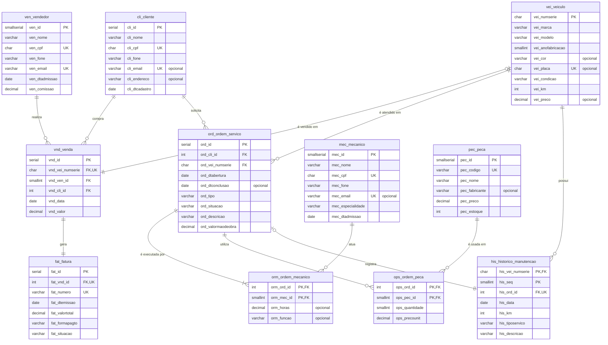
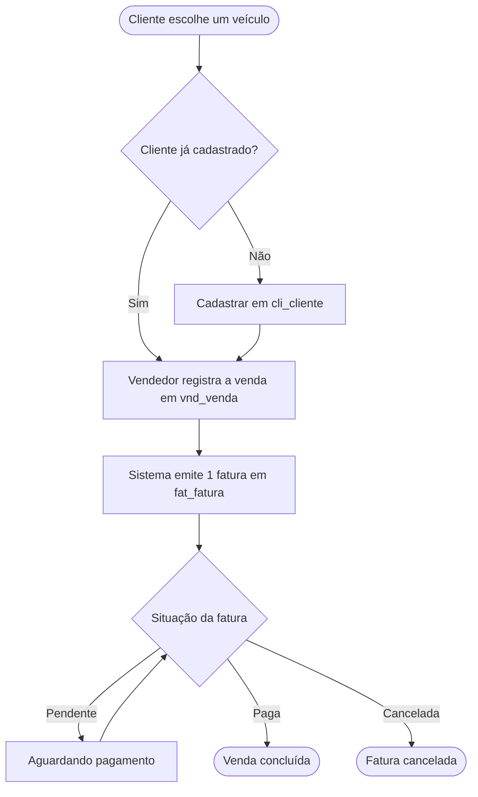
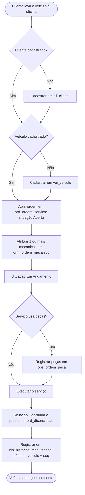

# concessionaria-tde
# Concessionária – Banco de Dados

Projeto de modelagem e implementação de um banco de dados relacional para uma concessionária de veículos que vende carros novos e usados e também oferece serviços de reparo e manutenção. Foi desenvolvido como atividade prática de Modelagem de Banco de Dados (Senac).

O banco cobre seis contextos do negócio:

- **Vendas de veículos:** cada carro é vendido por um único vendedor a um único cliente.
- **Faturamento:** cada venda gera uma única fatura.
- **Clientes:** podem ter comprado veículos ou usar apenas a oficina.
- **Ordens de serviço:** uma ordem específica para cada veículo atendido, da abertura à conclusão.
- **Histórico de manutenção:** registro dos serviços de cada veículo, identificado pelo número de série.
- **Mecânicos e peças:** uma ordem pode ter vários mecânicos e usar uma ou mais peças, ou nenhuma.

## Tecnologias utilizadas

| Tecnologia | Uso |
|---|---|
| PostgreSQL 16 | Sistema gerenciador de banco de dados (o script foi testado nesta versão) |
| SQL (DDL e DML) | Criação das tabelas, restrições e carga de dados de exemplo |
| DBeaver | Cliente para executar o script e consultar os dados |
| Mermaid | Diagramas do modelo entidade-relacionamento e dos fluxos, neste README |
| Git e GitHub | Versionamento e publicação do projeto |

## Estrutura do repositório

```
.
├── README.md
├── concessionaria.sql            # DROP, CREATE TABLE e INSERTs de cada tabela
└── concessionaria_tabelas.docx   # Análise de requisitos, relacionamentos e modelo lógico
```

## Como executar

1. Crie um banco de dados vazio no PostgreSQL (por exemplo, `concessionaria`).
2. Abra o arquivo `concessionaria.sql` no DBeaver, conectado a esse banco.
3. Execute o script inteiro com **Alt+X** (Execute Script). Com Ctrl+Enter o DBeaver executa só um comando.

Pelo terminal, o equivalente é:

```bash
psql -d concessionaria -f concessionaria.sql
```

O script começa com os `DROP TABLE IF EXISTS` na ordem inversa das dependências, então pode ser executado várias vezes.

## Modelo entidade-relacionamento



## Fluxos do negócio

### Venda e faturamento



### Ordem de serviço e histórico de manutenção



## Principais regras de negócio

- Um veículo só pode ser vendido uma vez (`UNIQUE` em `vnd_vei_numserie`).
- Cada venda tem exatamente um vendedor, um cliente e uma fatura (`fat_vnd_id` é único).
- Um cliente pode existir sem nunca ter comprado um veículo.
- Cada ordem de serviço é de um único veículo e um único cliente.
- Uma ordem pode ter vários mecânicos, e um mecânico pode atuar em várias ordens.
- Uma ordem pode usar várias peças ou nenhuma.
- Uma ordem "Concluída" exige data de conclusão, que não pode ser anterior à abertura.
- O histórico de manutenção é identificado pelo número de série do veículo mais uma sequência, e cada registro vem de uma única ordem do mesmo veículo.
- A regra "toda ordem tem ao menos um mecânico" não é imposta por constraint em SQL. Ela exigiria trigger ou validação na aplicação.

## Consultas de exemplo

```sql
SELECT v.vnd_id, c.cli_nome AS cliente, ve.ven_nome AS vendedor,
       vei.vei_modelo, v.vnd_valor, f.fat_numero, f.fat_situacao
FROM vnd_venda v
JOIN cli_cliente  c   ON c.cli_id = v.vnd_cli_id
JOIN ven_vendedor ve  ON ve.ven_id = v.vnd_ven_id
JOIN vei_veiculo  vei ON vei.vei_numserie = v.vnd_vei_numserie
JOIN fat_fatura   f   ON f.fat_vnd_id = v.vnd_id;

SELECT h.his_vei_numserie, h.his_seq, h.his_data, h.his_km,
       h.his_tiposervico, h.his_descricao
FROM his_historico_manutencao h
WHERE h.his_vei_numserie = '9BWZZZ377VT004251'
ORDER BY h.his_seq;
```